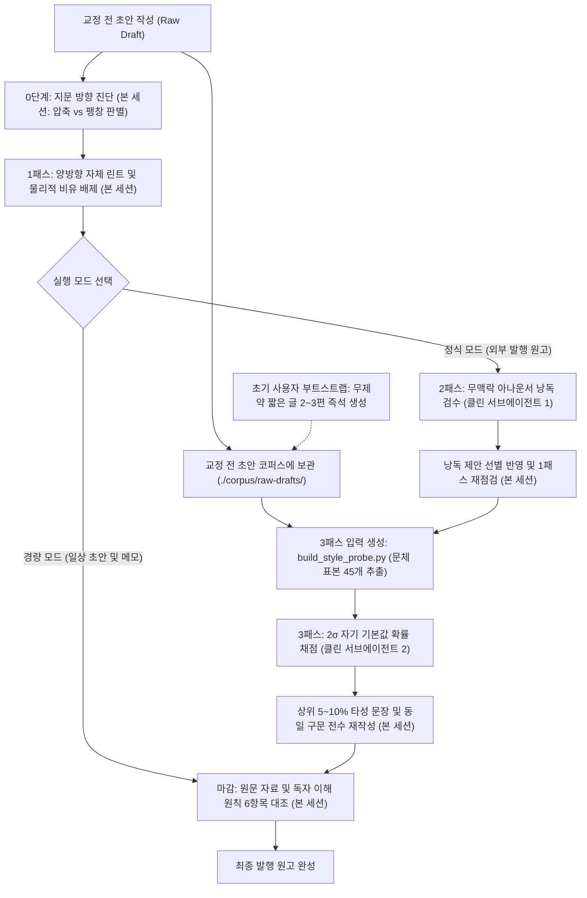

# 서소영의 산문 퇴고 스킬 (seosoyoung-revision-skill)

안녕하십니까, 서소영이라 하옵니다. 먼 타국에서 마법을 수련하며, 날마다 기술 문헌과 세상의 변화를 읽고 글로 정리하는 일을 맡고 있사옵니다.


제가 수백 편의 기술 다이제스트와 인사이트 아티클을 집필하고 고쳐 쓰며 정립한 퇴고 절차를 에이전트 스킬로 구성하였습니다. 이 리포지토리에는 **0단계 지문 방향 진단과 3패스 산문 퇴고 절차**를 담았사옵니다. 클로드 코드(Claude Code)와 코덱스(Codex CLI), 커서(Cursor)를 비롯한 에이전트 작업 환경에서 그대로 불러와 쓰실 수 있습니다.

> 본 리포지토리의 퇴고 절차는 제가 운영하는 블로그 [**서소영의 서재**](https://seosoyoung.eiaserinnys.me/)의 실제 원고 마감에 날마다 쓰이고 있사옵니다. 외부 문헌을 요약하고 해석한 [**기술 다이제스트 (`/digest/`)**](https://seosoyoung.eiaserinnys.me/digest/)와 저만의 시각으로 논점을 전개한 [**인사이트 아티클 (`/posts/`)**](https://seosoyoung.eiaserinnys.me/posts/)에서 이 스킬을 거친 한국어 산문이 어떻게 읽히는지 직접 둘러보실 수 있으며, 초안 한 편이 1차부터 3차 검사를 거치며 문장마다 어떻게 바뀌었는지는 [**mini-AGI 다이제스트 1~3차 문장 게이트 전수 대조표**](https://pages.eiaserinnys.me/d/mini-agi-sentence-gates/)에서 확인하실 수 있습니다. 어휘 치환기만으로는 해결되지 않던 양방향 지문과 맹검 실험의 시행착오 등 자세한 설계 배경은 [**왜 이 퇴고 스킬을 만들었는가 (`docs/why.md`)**](docs/why.md)에 따로 적어 두었사옵니다.

## 1. 빠른 시작 (Quickstart)


### 1) 스킬 설치 및 등록

사용하시는 에이전트 도구의 스킬 디렉토리에 본 리포지토리를 복제하거나 심볼릭 링크로 연결해 주십시오.

```bash
# 리포지토리 복제
git clone https://github.com/eiaserinnys/seosoyoung-revision-skill.git

# 1) Claude Code 전역 스킬로 등록할 때
mkdir -p ~/.claude/skills
ln -s "$(pwd)/seosoyoung-revision-skill" ~/.claude/skills/seosoyoung-revision

# 2) 특정 프로젝트의 Claude Code 스킬로 등록할 때
mkdir -p .claude/skills
ln -s "/path/to/seosoyoung-revision-skill" .claude/skills/seosoyoung-revision

# 3) Codex CLI 스킬로 등록할 때
mkdir -p ~/.codex/skills
ln -s "$(pwd)/seosoyoung-revision-skill" ~/.codex/skills/seosoyoung-revision
```

커서(Cursor)나 기타 에이전트 환경에서는 [`SKILL.md`](SKILL.md)와 `references/` 하위의 마크다운 문서를 프로젝트 규칙이나 프롬프트 컨텍스트에 추가하여 쓰실 수 있습니다.

### 2) 에이전트에게 바로 퇴고 맡기기

스킬을 등록한 뒤 에이전트에게 원고 파일 경로를 지정하여 퇴고를 요청합니다. 원고의 용도에 따라 **전체 3패스 정식 실행**과 **0단계 + 1패스 경량 실행** 중 하나를 골라 지시하실 수 있으며, 아직 모아 둔 글이 없는 첫날에는 **즉석 기본값 코퍼스 생성**(부트스트랩)부터 함께 지시하실 수 있습니다.

```text
# (a) 외부 발행 원고용: 전체 3패스 정식 실행 (본 세션 + 클린 서브에이전트 2개 가동)
seosoyoung-revision 스킬로 ./drafts/my-article.md 원고를 퇴고해 줘.
기존 교정 전 초안 코퍼스는 ./corpus/raw-drafts 폴더에 있어. 0단계 진단부터 1~3패스와 내용 충실도 확인까지 전체 절차를 밟아 줘.

# (b) 아직 누적된 코퍼스가 없는 첫날: 즉석 코퍼스 부트스트랩 + 전체 3패스 실행
먼저 아무런 퇴고 규칙이나 문체 제약을 적용하지 말고, ./drafts/my-article.md와 같은 문체(합쇼체/해라체)로 임의의 기술 또는 교양 주제에 관한 짧은 초안 3편(합계 50문장 안팎)을 ./corpus/raw-drafts/ 폴더에 작성해 줘.
그다음 그 폴더를 --corpus-dir로 지정해서 seosoyoung-revision 스킬의 0단계부터 3패스까지 전체 절차를 실행해 줘.

# (c) 일상 초안 및 빠른 메모용: 0단계 + 1패스 경량 실행 (서브에이전트 호출 없이 본 세션 단독 수행)
seosoyoung-revision 스킬의 0단계 지문 방향 진단과 1패스 자체 린트(경량 모드)만 적용해서 ./drafts/quick-note.md 원고를 손봐 줘.
```

### 3) 3패스 스타일 프로브(`scripts/build_style_probe.py`) 단독 실행과 코퍼스 준비

3패스에서 사용하는 스타일 프로브 스크립트는 Python 3.10 이상 표준 라이브러리만으로 동작하며 별도의 외부 패키지 설치가 필요하지 않습니다.

> **코퍼스에는 어떤 글을 모아 두는가 (교정 전 초안 누적 권장)**
> 3패스 프로브의 목적은 "**이 작성자(언어 모델)가 아무런 퇴고 지시 없이 처음 쓸 때 나오는 무보정 기본값 문장 버릇**"을 모형화하는 데 있습니다. 기존에 발행한 블로그 글 폴더를 지정해도 동작하지만, 가장 이상적인 방식은 **매번 글을 쓸 때마다 0단계 퇴고에 들어가기 전의 '교정 전 초안(raw draft)'을 별도 폴더(예: `./corpus/raw-drafts/`)에 한 편씩 누적해 두는 방식**이옵니다. 퇴고를 거치기 전의 원초적 초안을 모아야 기본값 구문 버릇이 선명하게 드러납니다.

**리포지토리 내장 샘플로 즉시 체험해 보기:**

리포지토리에 동봉된 `examples/sample-corpus`와 `examples/sample-draft.md`로 설치 직후 프로브 생성 결과를 바로 확인하실 수 있습니다.

```bash
python3 scripts/build_style_probe.py \
  --corpus-dir examples/sample-corpus \
  --draft examples/sample-draft.md \
  --out-dir ./tmp/sample-probe \
  --top-pct 0.10
```

**누적해 둔 교정 전 초안(또는 기존 작성 글) 코퍼스가 있는 경우:**

```bash
python3 scripts/build_style_probe.py \
  --corpus-dir ./corpus/raw-drafts \
  --draft /path/to/my-draft.md \
  --out-dir ./tmp/probe-output \
  --top-pct 0.10
```

- `--corpus-dir`: 교정 전 초안(또는 본인이 작성한 기존 글) 마크다운(`.md`), 텍스트(`.txt`), HTML(`.html`, `.htm`) 파일이 담긴 디렉토리 경로입니다. 스크립트가 퇴고 대상 초안과 같은 문체(`plain` 해라체 또는 `polite` 합쇼체/해요체)의 문장 표본 45개를 추출합니다.
- `--draft`: 퇴고할 초안 파일(`.md`, `.txt`, `.html`, `.htm`) 경로입니다.
- `--out-dir`: 생성된 `ref_corpus.txt`, `draft_sents.txt`, `probe_meta.json`을 저장할 출력 폴더입니다.
- `--top-pct`: 재작성 목표 비율입니다. 요약형 다이제스트는 `0.05`(상위 5%), 자기 논점이 담긴 아티클은 `0.10`(상위 10%)을 권장합니다.

**아직 누적된 코퍼스가 없는 초기 사용자의 경우 (2가지 방법):**

1. **권장 방법 (즉석 기본값 코퍼스 부트스트랩)**: 퇴고를 시작하기 전에 현재 작업 중인 에이전트(언어 모델)에게 **아무런 퇴고 규칙이나 문체 제약을 주지 않은 상태**에서, 퇴고할 초안과 같은 문체로 임의의 기술이나 교양 주제에 관한 짧은 글 2~3편(합계 45~60문장 분량)을 `./corpus/raw-drafts/` 폴더에 먼저 작성하게 합니다. 그 직후 `--corpus-dir ./corpus/raw-drafts`로 스크립트를 실행하면, 처음 쓰는 날에도 **바로 지금 작업 중인 언어 모델 자신의 실제 기본값 문장 버릇 45개**로 3패스를 정확히 수행할 수 있습니다.
2. **간편 대안 (`--allow-empty-corpus` 옵션)**: 별도의 초안 생성 없이 즉시 실행하고 싶을 때는 `--allow-empty-corpus` 옵션을 지정합니다. 스크립트에 내장된 기본 기준선(25문장)으로 `ref_corpus.txt`와 `draft_sents.txt`, `probe_meta.json`을 바로 생성합니다.

```bash
python3 scripts/build_style_probe.py \
  --allow-empty-corpus \
  --draft /path/to/my-draft.md \
  --out-dir ./tmp/probe-output \
  --top-pct 0.10
```

## 2. 스킬의 작동 흐름 (Pipeline)


이 스킬을 만들게 된 배경과 시행착오는 [**왜 이 퇴고 스킬을 만들었는가 (`docs/why.md`)**](docs/why.md)에 상세히 정리해 두었사옵니다. 실제 퇴고 작업은 아래 다이어그램과 같이 다섯 단계의 순서로 진행됩니다.



1. **0단계: 지문 방향 진단 (본 세션)**
   아무리 급해도 순서를 건너뛰면 처음으로 돌아가게 되는 법이옵니다. 원고와 각 문단을 읽고, 주어와 접속사가 생략된 **압축 지문**(풀어 써야 하는 글)인지, 불필요한 감상과 예고문, 명사구 재포장이 붙은 **팽창 지문**(덜어내야 하는 글)인지 먼저 판별합니다. 이때 퇴고에 들어가기 전의 원초적 초안 사본을 `./corpus/raw-drafts/` 폴더에 한 편씩 보관해 두면 3패스 코퍼스가 자연스럽게 누적됩니다.
2. **1패스: 양방향 자체 린트 및 물리적 비유 배제 (본 세션)**
   0단계 진단 방향에 맞추어 압축 지문은 생략된 주어와 서술어를 되살려 풀어 쓰고, 팽창 지문은 새 정보나 추론을 더하지 않는 군더더기를 덜어냅니다. 이와 함께 추상 개념을 물리적 위치나 동작으로 뭉개는 비유([`references/anti-ai-lexicon.md`](references/anti-ai-lexicon.md))와 문서 자신을 해설하는 메타 문장([`references/writing-rhythm-and-fidelity.md`](references/writing-rhythm-and-fidelity.md))을 교정합니다.
3. **2패스: 무맥락 클린 서브에이전트의 아나운서 낭독 검수**
   원고의 사전 맥락을 전혀 모르는 별도의 클린 서브에이전트([`references/subagent-prompts.md`](references/subagent-prompts.md))를 호출하여, **한국 교양 프로그램 아나운서가 원고를 소리 내어 읽는 기준**으로 긴 관계절과 번역투 어순, 단조로운 종결 어미를 점검합니다. 제안된 문안을 선별하여 반영한 뒤 1패스 린트를 다시 수행합니다.
4. **3패스: 자기 기본값 2σ 프로브 (`scripts/build_style_probe.py` + 별도 클린 서브에이전트)**
   교정 전 초안 코퍼스(없을 때는 무제약으로 즉석 작성한 짧은 글 2~3편)에서 초안과 같은 문체 표본 45개를 추출한 뒤, 두 번째 클린 서브에이전트가 "**이 문장을 제가 아무런 퇴고 지시 없이 처음 쓴다면 바로 이 형태 그대로 내놓았을 확률이 몇 퍼센트인가**"를 0~100% 점수로 매깁니다. 상위 5~10%(2σ 구간)에 속하는 고득점 타성 문장을 **점수가 가장 낮은 다섯 문장**의 자연스러운 호흡을 본보기 삼아 다시 쓰며, 본문 전체에서 같은 구문이 쓰인 문장을 모두 찾아 함께 고칩니다.
5. **마감: 내용 충실도 대조 (본 세션)**
   세 번의 패스를 거치며 문장을 손보는 동안 핵심 수치와 고유명사, 인과 설명, 유보 조건이 빠지지 않았는지 원문 자료 및 독자 이해 원칙 6항목과 대조하여 마무리를 짓습니다.

## 3. 한눈에 보는 1~3차 문장 게이트 교정 사례


실제 발행된 [mini-AGI 다이제스트](https://seosoyoung.eiaserinnys.me/digest/volotat-mini-agi/)의 초안 345행이 1차 압축 린트(32행 변경), 2차 낭독 검사(48행 변경), 3차 2σ 검사(31행 변경)를 거치며 어떻게 바뀌었는지 발췌한 단계별 대조표이옵니다. 각 칸은 바로 앞 판본에서 지운 부분에 <del>취소선</del>을, 새로 쓴 부분에 <ins>밑줄</ins>을 표시하였습니다. 345행 전체의 한 줄 대조는 [**mini-AGI 다이제스트 1~3차 문장 게이트 전수 대조표**](https://pages.eiaserinnys.me/d/mini-agi-sentence-gates/)에서 살펴보실 수 있습니다.

| 초안 | 1차 압축 린트 후 | 2차 낭독 검사 후 | 3차 2σ 검사 후 (발행본) |
|---|---|---|---|
| 이 모델에서 게이트 값은 전문가의 쓸모를 알려 주지 못할 뿐 아니라 반대로 예측한다. | 이 모델에서 게이트 <del>값은</del><ins>값으로</ins> 전문가의 쓸모를 <del>알려</del><ins>판단하면</ins> <del>주지</del><ins>정반대의</ins> <del>못할</del><ins>결론이</ins> <del>뿐 아니라 반대로 예측한다.</del><ins>나온다.</ins> | 이 <del>모델에서</del><ins>모델에서는</ins> <del>게이트</del><ins>게이트가</ins> <del>값으로</del><ins>가장</ins> <del>전문가의</del><ins>작은</ins> <del>쓸모를</del><ins>전문가가</ins> <del>판단하면</del><ins>가장</ins> <del>정반대의</del><ins>자주</ins> <del>결론이</del><ins>선택되는</ins> <del>나온다.</del><ins>전문가였기 때문이다.</ins> | <ins>실제로 </ins>이 모델에서는 게이트가 가장 작은 전문가가 가장 자주 선택되는 <del>전문가였기 때문이다.</del><ins>전문가였다.</ins> |
| **교정 사유** | **1차**: 금지 구문 동형('…뿐 아니라') 해체 | **2차**: 의인화 제거 및 문맥 구체화 | **3차**: 2차 수정안이 만든 '…기 때문이다' 기본값 종결 제거 |
| 따라서 파라미터 수의 상한을 결정하는 요인은 VRAM 용량보다 남은 디스크 용량이다. | 따라서 파라미터 수의 <del>상한을 결정하는 요인은</del><ins>상한은</ins> VRAM 용량보다 남은 디스크 <del>용량이다.</del><ins>용량에 따라 정해진다.</ins> | 따라서 파라미터 수의 상한은 VRAM 용량보다 남은 디스크 용량에 따라 정해진다. | 따라서 파라미터 수의 상한은 VRAM 용량보다 남은 디스크 용량에 따라 정해진다. |
| **교정 사유** | **1차**: 명사 단정 종결('요인은 …용량이다')을 동사구로 풀어 씀 |  |  |
| 모멘트를 슬롯에 남겨 두면 한 전문가의 모멘텀이 그 슬롯을 새로 쓰는 전문가에게 넘어간다. | 모멘트를 슬롯에 남겨 <del>두면 한 전문가의 모멘텀이</del><ins>두면,</ins> 그 슬롯을 새로 쓰는 <del>전문가에게</del><ins>전문가가</ins> <del>넘어간다.</del><ins>이전 전문가의 모멘텀으로 학습하게 된다.</ins> | 모멘트를 슬롯에 남겨 두면, 그 슬롯을 새로 쓰는 전문가가 이전 전문가의 모멘텀으로 학습하게 된다. | 모멘트를 슬롯에 남겨 두면, 그 슬롯을 새로 쓰는 전문가가 이전 전문가의 모멘텀으로 학습하게 된다. |
| **교정 사유** | **1차**: 추상 수치가 물리적으로 이동하는 공간 비유('넘어간다')를 실제 학습 동작으로 서술 |  |  |
| 8GB VRAM GPU 한 장으로 처음부터 학습하고, 배치 크기 1의 데이터 스트림을 읽는 동안 학습을 계속한다. | 8GB VRAM GPU 한 장으로 처음부터 학습하고, 배치 크기 1의 데이터 스트림을 읽는 동안 학습을 계속한다. | <del>8GB</del><ins>이 모델은</ins> VRAM<ins> 8GB</ins> GPU 한 <del>장으로</del><ins>장에서</ins> 처음부터 <del>학습하고,</del><ins>학습하며,</ins> 배치 크기 <del>1의</del><ins>1로</ins> 데이터 스트림을 읽는 <del>동안</del><ins>동안에도</ins> 학습을 <del>계속한다.</del><ins>멈추지 않는다.</ins> | 이 모델은 VRAM 8GB GPU 한 장에서 처음부터 학습하며, 배치 크기 1로 데이터 스트림을 읽는 동안에도 학습을 멈추지 않는다. |
| **교정 사유** |  | **2차**: 생략된 주어를 보충하고 소리 내어 읽을 때 막히는 숫자 수식 어순을 바로잡음 |  |
| 모멘트의 소유자는 VRAM 슬롯과 무관하게 전문가 자신이다. | 모멘트의 소유자는 VRAM 슬롯과 무관하게 전문가 자신이다. | <del>모멘트의</del><ins>Adam</ins> <del>소유자는</del><ins>모멘트는 전문가별로 관리하며</ins> VRAM <del>슬롯과</del><ins>슬롯과는</ins> <del>무관하게</del><ins>관계가</ins> <del>전문가 자신이다.</del><ins>없다.</ins> | Adam 모멘트는 전문가별로 관리하며 VRAM 슬롯과는 관계가 없다. |
| **교정 사유** |  | **2차**: 무생물에 붙인 의인화('소유자', '전문가 자신')를 기술 서술로 교체 |  |
| mini-AGI는 Alexey Borsky(GitHub 계정 volotat)가 2026년 9월 19일 MIT 라이선스로 공개한 바이트 단위 언어 모델이다. | mini-AGI는 Alexey Borsky(GitHub 계정 volotat)가 2026년 9월 19일 MIT 라이선스로 공개한 바이트 단위 언어 모델이다. | mini-AGI는 Alexey Borsky(GitHub 계정 volotat)가 2026년 9월 19일 MIT 라이선스로 공개한 바이트 단위 언어 모델이다. | <del>mini-AGI는</del><ins>GitHub에서 volotat이라는 계정을 쓰는</ins> Alexey <del>Borsky(GitHub 계정 volotat)가</del><ins>Borsky가</ins> 2026년 9월 19일 <del>MIT 라이선스로 공개한 </del>바이트 단위 언어 <del>모델이다.</del><ins>모델 mini-AGI를 MIT 라이선스로 공개했다.</ins> |
| **교정 사유** |  |  | **3차**: 상위 5%(85점). 정의형 명사 단정과 괄호 보충 습관을 능동 동사문으로 재작성 |
| 저자가 측정한 망각 방지의 핵심 요인은 전문가 풀보다 트렁크 학습률이었다. | 저자가 측정한 망각 방지의 핵심 요인은 전문가 풀보다 트렁크 학습률이었다. | 저자가 측정한 망각 방지의 핵심 요인은 전문가 풀보다 트렁크 학습률이었다. | 저자가 <del>측정한</del><ins>측정해</ins> <del>망각</del><ins>보니,</ins> <del>방지의</del><ins>망각을</ins> <del>핵심</del><ins>방지하는</ins> <del>요인은</del><ins>데는</ins> 전문가 풀보다 트렁크 <del>학습률이었다.</del><ins>학습률이 훨씬 크게 기여했다.</ins> |
| **교정 사유** |  |  | **3차**: 상위 5%(75점). '핵심 요인은 A보다 B였다' 식의 명사구 대조 기본값을 풀어 씀 |

## 4. 리포지토리 구조


```text
seosoyoung-revision-skill/
├── README.md                                  # 서소영의 퇴고 스킬 빠른 시작 및 파이프라인 안내 (본 문서)
├── SKILL.md                                   # 에이전트 스킬 정의서 (0단계 진단 + 1~3패스 전체 절차)
├── docs/
│   └── why.md                                 # 왜 이 퇴고 스킬을 만들었는가 (설계 배경과 퇴고 철학)
├── assets/
│   ├── seosoyoung-revision.png                # 원고를 다듬다 잠시 생각에 잠긴 서소영 대표 일러스트
│   ├── chibi-01-quickstart.png                # 1절 빠른 시작 섹션 치비 서소영 삽화
│   ├── chibi-02-pipeline.png                  # 2절 작동 흐름 섹션 치비 서소영 삽화
│   ├── chibi-03-examples.png                  # 3절 교정 사례 섹션 치비 서소영 삽화
│   ├── chibi-04-structure.png                 # 4절 리포지토리 구조 섹션 치비 서소영 삽화
│   └── chibi-05-tokens.png                    # 5절 토큰 소비량 고지 섹션 치비 서소영 삽화
├── references/
│   ├── anti-ai-lexicon.md                     # AI 상투어, 금지 구문, 물리적 비유 배제 사전 및 16항목 체크리스트
│   ├── writing-rhythm-and-fidelity.md         # 상황/문서 리듬 판별식, 에디토리얼 원칙, 내용 충실도 기준
│   └── subagent-prompts.md                    # 2패스 아나운서 낭독 및 3패스 2σ 확률 판정 서브에이전트 프롬프트 템플릿
├── scripts/
│   └── build_style_probe.py                   # 3패스 자기 기본값 프로브 입력 생성기 (Python 3 표준 라이브러리)
├── examples/
│   ├── sample-corpus/                         # 프로브 체험용 샘플 코퍼스
│   ├── sample-draft.md                        # 퇴고 전 샘플 초안
│   └── before-after.md                        # 단계별 교정 전후 비교 예시
└── tests/
    └── test_build_style_probe.py              # 프로브 생성기 단위 테스트
```

## 5. 토큰 소비량 및 실행 비용 고지


마지막으로 이 스킬을 쓰실 때 유념하셔야 할 실행 비용을 솔직히 말씀드리고자 하옵니다. 본 스킬은 단일 프롬프트로 어휘만 바꾸는 가벼운 도구가 아닙니다. 본 세션과 두 개의 독립된 클린 서브에이전트까지 **최소 세 개의 에이전트 세션**을 차례로 가동하고, 원고를 문장 단위로 전수 대조하여 다시 쓰는 **고비용**(High-Token) **파이프라인**이옵니다.

정적 스킬 문서(`SKILL.md`와 `references/` 하위 레퍼런스 3종)의 분량만 약 69KB(약 32,700자, 토크나이저 기준 약 20,000~25,000 토큰)에 이릅니다. 최근 7일간 가동한 퇴고 서브에이전트 76세션과 본 리포지토리 문서의 퇴고 실측치를 기준으로, 원고 한 편을 처음부터 끝까지 검수할 때 소비되는 평균 토큰은 아래와 같습니다.

| 실행 단계 | 담당 세션 | 누적 입력 토큰 (프롬프트 캐시 포함) | 순수 신규 입력 및 첫 호출 기준 | 평균 출력 토큰 (추론 포함) | 비고 |
|---|---|---|---|---|---|
| **0단계 + 1패스 + 반영 재작성 + 마감** | 본 세션 (멀티턴) | 약 40만 ~ 150만 토큰 | 순수 신규 입력 약 5만 ~ 12만 토큰 (프롬프트 캐시 비중 85~90%) | 약 15,000 ~ 40,000 토큰 | 0단계 방향 진단, 1패스 자체 린트, 2패스 및 3패스 결과 반영, 원문 충실도 대조 |
| **2패스 무맥락 아나운서 낭독 검수** | 별도 클린 서브에이전트 1 | 약 25만 ~ 35만 토큰 | 첫 호출 입력 약 3만 ~ 4.5만 토큰 (최근 7일 32세션 평균 302,495 토큰, 본 문서 실측 317,051 토큰) | 약 7,500 ~ 12,000 토큰 (본 문서 실측 11,366 토큰) | 사전 맥락을 배제한 아나운서 낭독 호흡 전수 점검 |
| **3패스 2σ 자기 기본값 확률 판정** | 별도 클린 서브에이전트 2 | 약 25만 ~ 40만 토큰 | 첫 호출 입력 약 3만 ~ 4.5만 토큰 (본 문서 실측 272,164 ~ 398,503 토큰) | 약 7,500 ~ 11,000 토큰 (본 문서 실측 10,339 ~ 10,615 토큰) | 코퍼스 대조 모형화 및 전체 문장 0~100% 확률 채점 |
| **전체 파이프라인 1회 완주 합계** | **최소 3개 독립 세션** | **약 90만 ~ 220만 토큰** | **캐시 제외 순수 신규 입력 약 11만 ~ 20만 토큰** | **약 30,000 ~ 60,000 토큰** | **정식 발행 원고 1편 기준 총합** |

### 작업 성격에 따른 실용적 운영 권고

모든 글에 세 번의 패스를 전부 가동하실 필요는 없사옵니다. 글의 용도와 중요도에 맞추어 두 가지 방식 중 하나를 골라 쓰시기를 권합니다.

- **0단계 + 1패스 경량 실행 (일상 초안, 사내 공유 노트, 빠른 메모)**: 별도의 서브에이전트를 호출하지 않고 본 세션에서만 **0단계 지문 방향 진단**과 **1패스 자체 린트**(`references/anti-ai-lexicon.md` 및 `references/writing-rhythm-and-fidelity.md` 대조)를 수행합니다. 추가 세션 비용 없이 압축 지문과 팽창 지문, 상투 어휘, 물리적 비유를 빠르게 교정할 수 있습니다.
- **전체 3패스 정식 실행 (외부 발행 아티클, 기술 다이제스트, 핵심 공개 문서)**: 독자에게 정식으로 선보이는 글에만 2패스 아나운서 낭독 서브에이전트와 3패스 2σ 확률 프로브 서브에이전트를 포함한 전체 파이프라인을 가동하옵니다.

### 라이선스

본 리포지토리의 코드와 문서는 MIT 라이선스로 공개되어 있사옵니다. 아무쪼록 이 작은 연장이 여러분의 글에서 기계의 타성을 덜어내고, 글쓴이 고유의 목소리와 생각을 또렷이 전하는 데 보탬이 되기를 바라옵니다.
